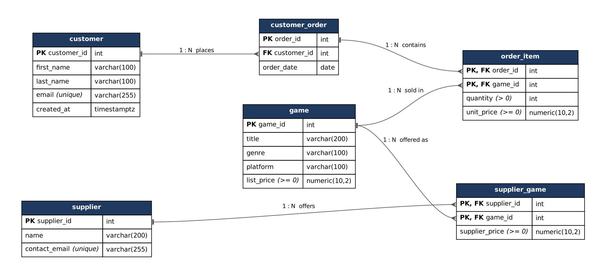

# Game Store Database

[](https://github.com/mirzamemovic/game-store-db/actions/workflows/ci.yml)


A relational database for a video-game retailer, built in PostgreSQL. It models customers, orders, a game catalogue and competing suppliers, and answers the questions a shop owner actually asks: **how much did we make each month, who are our best customers, what isn't selling, and which supplier is cheapest.**

- **6 normalized tables** (3NF) with foreign keys, CHECK constraints, composite keys and indexes
- **15+ SQL queries**, from joins and aggregates to window functions and margin analysis
- **18 automated tests** that run on every push through GitHub Actions
- **One-command setup** with Docker

---

## Contents

- [Data model](#data-model)
- [Sample results](#sample-results)
- [Quick start](#quick-start)
- [Project structure](#project-structure)
- [Design decisions](#design-decisions)
- [Testing](#testing)
- [About this project](#about-this-project)

---

## Data model



| Table | Holds | Primary key |
|---|---|---|
| `customer` | Customers and their contact email | `customer_id` |
| `customer_order` | One purchase by a customer on a date | `order_id` |
| `order_item` | Each game in an order, quantity, and price paid per copy | `(order_id, game_id)` |
| `game` | Catalogue with current list price | `game_id` |
| `supplier` | Wholesale suppliers | `supplier_id` |
| `supplier_game` | Which supplier sells which game, and for how much | `(supplier_id, game_id)` |

---

## Sample results

Output from [`sql/03_queries.sql`](sql/03_queries.sql) on the included seed data.

**Revenue per month**

| month | orders | units | revenue |
|---|--:|--:|--:|
| 2025-01 | 4 | 13 | 529.87 |
| 2025-02 | 4 | 11 | 559.89 |
| 2025-03 | 4 | 8 | 359.92 |
| 2025-04 | 4 | 7 | 329.93 |
| 2025-05 | 4 | 7 | 289.93 |
| 2025-06 | 4 | 6 | 259.94 |

**Top customers by spend** — uses `RANK()` so tied customers aren't dropped

| customer | orders | total spent |
|---|--:|--:|
| Jane Smith | 3 | 419.92 |
| John Doe (#1) | 3 | 369.92 |
| Patricia Williams | 2 | 299.95 |

**Gross margin per game** — sale price vs. the cheapest supplier, top 5

| game | units | revenue | margin | margin % |
|---|--:|--:|--:|--:|
| The Last of Us Part II | 4 | 239.96 | 81.96 | 34.2 |
| Zelda: Breath of the Wild | 5 | 299.95 | 74.95 | 25.0 |
| Minecraft | 6 | 179.94 | 74.94 | 41.6 |
| Animal Crossing: New Horizons | 4 | 239.96 | 61.96 | 25.8 |
| Call of Duty: Modern Warfare III | 3 | 209.97 | 57.27 | 27.3 |

<details>
<summary><b>All queries in the project</b></summary>

| # | Question | Technique |
|---|---|---|
| 1.1–1.4 | Customers, orders by customer, orders by date | `SELECT`, `WHERE`, views |
| 2.1 | Orders per customer, including customers with none | `LEFT JOIN`, `GROUP BY` |
| 2.2 | Units and revenue for one game | aggregates |
| 2.3 | Highest price each game sold for | `MAX` |
| 2.4 | Every supplier offer per game | 3-table join |
| 3.1 | Revenue per month | `date_trunc` |
| 3.2 | Top 5 customers | `RANK()` window function |
| 3.3 | Games never sold | anti-join (`LEFT JOIN … IS NULL`) |
| 3.4 | Cheapest supplier per game | `RANK() OVER (PARTITION BY …)` |
| 3.5 | Gross margin per game | CTE |
| 3.6 | Revenue by platform | aggregates |
| 3.7 | Order totals | view |
| 4.x | Update quantity, change price, remove a line | `UPDATE`, `DELETE` in a rolled-back transaction |

</details>

---

## Quick start

### Option 1 — Docker (recommended)

```bash
git clone https://github.com/mirzamemovic/game-store-db.git
cd game-store-db
docker compose up -d
```

This starts PostgreSQL 16 with the schema and data already loaded. Then:

```bash
docker exec -it game-store-db psql -U postgres -d game_store -f /sql/03_queries.sql   # run the reports
docker exec -it game-store-db psql -U postgres -d game_store -f /tests/run_tests.sql  # run the tests
```

Connect from any database tool (DBeaver, pgAdmin, Valentina Studio) at `localhost:5432`, database `game_store`, user `postgres`, password `postgres`.

### Option 2 — Existing PostgreSQL install

```bash
createdb game_store
psql -d game_store -f sql/01_schema.sql
psql -d game_store -f sql/02_seed.sql
psql -d game_store -f sql/03_queries.sql
psql -d game_store -f tests/run_tests.sql
```

In a GUI tool, open the same files in a SQL editor and run them in that order. All scripts are safe to re-run.

---

## Project structure

```
game-store-db/
├── sql/
│   ├── 01_schema.sql       tables, constraints, indexes, views
│   ├── 02_seed.sql         16 customers, 18 games, 24 orders over 6 months, 5 suppliers
│   └── 03_queries.sql      reports and business questions
├── tests/
│   └── run_tests.sql       18 automated integrity and result tests
├── docs/
│   ├── er-diagram.png      entity-relationship diagram
│   └── er-diagram.dot      diagram source (Graphviz)
├── .github/workflows/
│   └── ci.yml              runs everything against PostgreSQL on every push
└── docker-compose.yml      one-command local database
```

---

## Design decisions

**The database enforces the rules, not the application.** Every relationship has a foreign key, quantities must be positive and prices non-negative. An order for a customer who doesn't exist is rejected by PostgreSQL itself, so no future app can corrupt the data by forgetting a check.

**Composite keys on the junction tables.** `order_item` is keyed on `(order_id, game_id)` and `supplier_game` on `(supplier_id, game_id)`. The same game can't be added to an order twice, and a supplier can't list the same game twice.

**Price paid is stored separately from list price.** `order_item.unit_price` records what the customer paid; `game.list_price` is today's price. Sales and price changes don't rewrite past revenue.

**Customers are identified by ID, never by name.** The seed data deliberately includes two different people named John Doe. Every per-customer report groups by `customer_id`, so they stay separate.

**Deletes are explicit.** Deleting an order removes its lines (`CASCADE`), but a customer with orders can't be deleted (`RESTRICT`). Losing sales history should never happen by accident.

**Indexes on foreign keys.** PostgreSQL doesn't index foreign-key columns automatically. Columns not already covered by a primary key are indexed, plus `order_date` for date-range reports.

**Normalized to 3NF.** No repeated groups (1NF). Non-key columns in the junction tables depend on the whole composite key (2NF). Customer details aren't copied into orders, and order totals are computed in the `order_details` view rather than stored (3NF).

---

## Testing

[`tests/run_tests.sql`](tests/run_tests.sql) runs 18 checks and stops at the first failure:

- **Integrity (8)** — orphan orders, unknown games, zero quantity, negative price, duplicate order lines, duplicate supplier offers and duplicate emails are all rejected; a customer with orders can't be deleted
- **Behaviour (1)** — deleting an order removes its lines
- **Results (9)** — row counts, total revenue, the view matching the raw data, same-name customers counted separately, unsold games, cheapest supplier

GitHub Actions runs the full setup and test suite against a fresh PostgreSQL 16 container on every push, then runs it a second time to confirm the scripts are re-runnable.

```
NOTICE:  PASS  order for non-existent customer is rejected
NOTICE:  PASS  zero quantity is rejected
NOTICE:  PASS  same game twice in one order is rejected
...
NOTICE:  PASS  two customers with the same name are counted separately
All tests passed.
```

---

## About this project

Built as coursework for the BSc in Applied Information Technology at International Business College Mitrovica (IBCM), Kosovo, then extended beyond the assignment with constraints, tests, CI and Docker.

<details>
<summary><b>Changes since the original submission</b></summary>

| Original | Problem | Fix |
|---|---|---|
| No foreign keys | Relationships existed only in the diagram; orphan rows were accepted | Foreign keys on every relationship |
| `OrderPrice` held the line total, but a view multiplied it by quantity again | Two queries reported different revenue for the same order | Renamed to `unit_price` (one copy); all revenue is `quantity * unit_price` |
| Surrogate `OrderItemId`, while the 2NF notes described a composite key | The same game could appear twice in one order | Composite primary keys on both junction tables |
| Orders per customer grouped by name | Two people with the same name were merged | Grouped by `customer_id` |
| ER diagram showed IDs as strings | Diagram didn't match the SQL | Diagram regenerated from the schema |
| No CHECK constraints or indexes | Invalid quantities accepted; joins unindexed | Both added |
| Query on a missing `Employee` table; a corrupted view definition | The script failed when run top to bottom | Removed and rewritten; full suite runs in CI |

</details>

**Author:** Mirza — [GitHub](https://github.com/mirzamemovic)

Licensed under the [MIT License](LICENSE).
